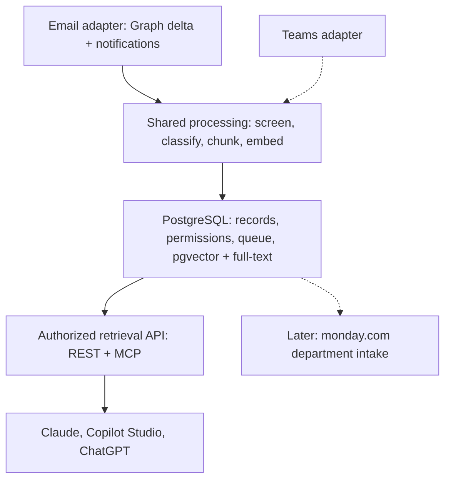

# Finishes Communication Intelligence

Shared communication intelligence platform for **email, Teams, Fireflies and Dialpad**. The first release is **authorized semantic search over Microsoft 365 email** for executives, queried from Claude, Microsoft Copilot (Copilot Studio) and ChatGPT, each signing in as themselves. Teams follows; Fireflies and Dialpad are undecided.

**Current status: planning; implementation starting.** This repository contains architecture plans, an Azure/Graph setup runbook, an identity bootstrap script and a draft database migration (validated locally, not applied in Azure). No application code, infrastructure template or deployment workflow exists yet, and no Azure resources have been deployed by this repository.

**Building here?** Read [`CLAUDE.md`](CLAUDE.md) first. It records the locked and open decisions and the PR sequence, and it wins where it disagrees with `docs/`.

## Start Here

| Document | Purpose |
|---|---|
| [CLAUDE.md](CLAUDE.md) | Build context: decisions, email pipeline, local dev, acceptance metrics, PR sequence |
| [Architecture Decisions](docs/ARCHITECTURE_DECISIONS.md) | ADRs, including email-first (ADR-014), mailbox scope (ADR-015), attachment policy (ADR-016), classification and clients (ADR-017), PostgreSQL/Python/Flex (ADR-018) |
| [Email Release Backlog](docs/EMAIL_RELEASE_BACKLOG.md) | Email tasks |
| [Email Layers and PDF Scope](docs/EMAIL_PIPELINE_AND_PDF_SCOPE.md) | Pipeline layers; PDF extraction arrives in E2 |
| [Email Deduplication](docs/EMAIL_DEDUPLICATION.md) | Cross-mailbox copies, fingerprints, collapsing after authorization |
| [Email Acceptance Plan](docs/EMAIL_ACCEPTANCE_PLAN.md) | Pilot scenarios and release evidence |
| [Function Apps](docs/FUNCTION_APPS.md) | Ingestion and search apps, identities, resource inventory |
| [Database](docs/DATABASE.md) | Schema, publication fence, queue, roles; see [`db/migrations`](db/migrations) |
| [Search and Agents](docs/SEARCH_AND_AGENTS.md) | Chunking, embeddings, hybrid retrieval, authorization, REST/MCP |
| [Platform Plan](docs/PLATFORM_PLAN.md) | Overall architecture and common data model |
| [Azure and Graph Setup](docs/AZURE_AND_GRAPH_SETUP.md) | GitHub/Azure authentication, identities, scoped mailbox permissions |
| [Azure Bootstrap](scripts/bootstrap-azure.sh) | Cloud Shell script for identities, federation and deploy roles in the existing resource group |
| [Runtime Configuration Example](config/runtime.example.env) | Proposed setting names |
| [Fireflies Pipeline](docs/FIREFLIES_PIPELINE.md) / [Backlog](docs/FIREFLIES_RELEASE_BACKLOG.md) | Reference only: written when Fireflies was first (superseded by ADR-014) |

## Source Roadmap

| Source | Planned Coverage | Release Scope |
|---|---|---|
| Microsoft 365 email | All user and shared mailboxes minus exclusions; body text (E1), then PDF extraction/OCR (E2) | **First release** |
| Teams | Authorized chats, channel messages and available meeting evidence | Second; no code yet |
| Fireflies | Meeting transcripts | Undecided |
| Dialpad | Calls, messages, transcripts | Undecided |

## Platform Shape

Mailbox access is bounded by Exchange Online Application RBAC (ADR-015); tenant-wide Graph `Mail.Read` is never granted. Shared processing screens content in-tenant, classifies it into proposals (never approvals), chunks and embeds it, and publishes atomically. Search applies authorization in SQL before ranking. PostgreSQL is the queue and the search index for the first release (ADR-012, ADR-018).

## Delivery Order

The PR sequence lives in [`CLAUDE.md`](CLAUDE.md) §12: docs alignment, scaffold and CI, database, local stack (fixtures, no Azure), capture, processing, search, dev infrastructure, a real test mailbox, agent clients, then operations and E2.

The operator control is `INGESTION_MODE=test|production|paused`, stored as the active `runtime_config` revision in PostgreSQL (ADR-011). An empty scope fails closed. See [ADR-004](docs/ARCHITECTURE_DECISIONS.md#adr-004-one-shared-mode-setting).

## Repository and Prototype

This is the authoritative repository: `Finishes-Solutions/fs-communication-intelligence`.

It was empty when inspected on September 25, 2026. The earlier email prototype in `mattsinitiere/fs-outlook-email-ingestion-tool` remains reference material. Its PR was closed as superseded; its code and passing tests have not been imported or represented as validation of this platform.

Committing these files does not create source permissions, ingest company communications, configure monday boards or deploy cloud services. The existing Azure resource group is `fs-communication-intelligence`. Running the bootstrap yourself creates managed identities, GitHub federation and deployment role assignments inside that group as described in the setup runbook.
