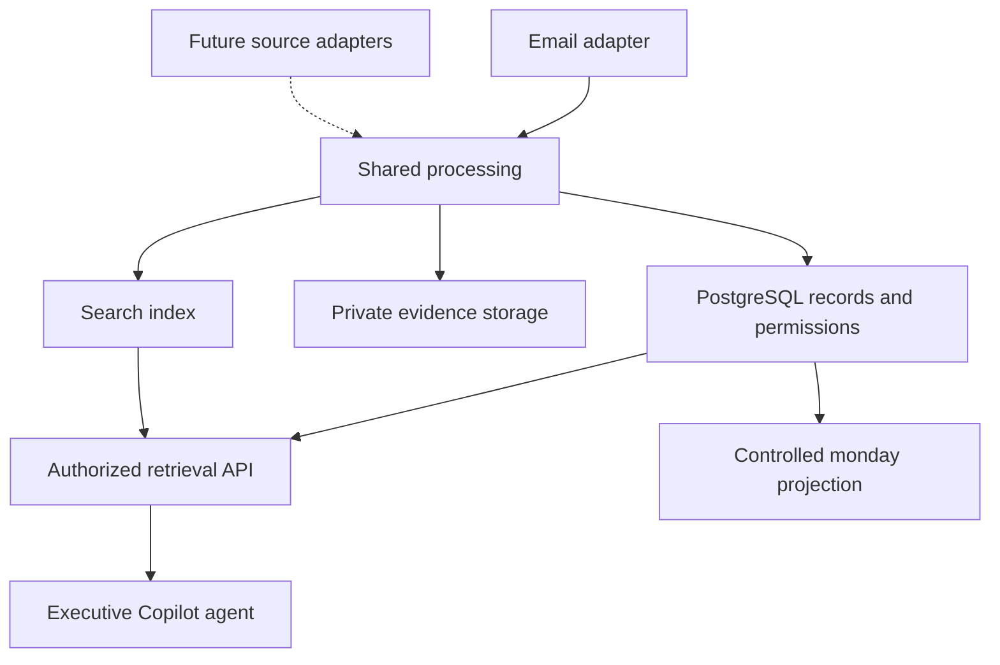

# Finishes Communication Intelligence

Shared communication intelligence platform for **email, Teams, Fireflies and Dialpad**, beginning with the **Email Intelligence Tool**.

**Current status: planning and setup preparation.** This repository contains architecture/delivery plans, an Azure/Graph setup runbook and an executable identity bootstrap. No ingestion application, complete infrastructure template or deployment workflow is implemented here yet. No Azure resources have been deployed by this repository work. Runtime configuration examples remain proposed contracts.

## Start Here

| Document | Purpose |
|---|---|
| [Azure and Graph Setup](docs/AZURE_AND_GRAPH_SETUP.md) | Resource inventory, GitHub/Azure authentication, scoped mailbox permissions and runtime access tests |
| [Azure Bootstrap](scripts/bootstrap-azure.sh) | Cloud Shell script for the resource group, identities, federation and deployment roles |
| [Platform Plan](docs/PLATFORM_PLAN.md) | Architecture, common data model, source boundaries, access, lifecycle, repository layout and deployment strategy |
| [Email Release Backlog](docs/EMAIL_RELEASE_BACKLOG.md) | Ordered implementation tasks and acceptance criteria for the first release |
| [Architecture Decisions](docs/ARCHITECTURE_DECISIONS.md) | Proposed technology and behavior decisions, including the shared mode switch |
| [Email Acceptance Plan](docs/EMAIL_ACCEPTANCE_PLAN.md) | Pilot scenarios and production release evidence |
| [Runtime Configuration Example](config/runtime.example.env) | Proposed setting names and safe starting values |

## Source Roadmap

| Source | Planned Coverage | Release Scope |
|---|---|---|
| Microsoft 365 email | Approved user/shared mailboxes, sent/received mail, attachment extraction and citations | First release |
| Teams | Authorized chats, channel messages and available meeting evidence | Later; disabled |
| Fireflies | Authorized meeting transcripts, speakers, timestamps and summaries | Later; disabled |
| Dialpad | Authorized calls, messages and available transcript/media evidence | Later; disabled |

Future provider coverage, permissions and account entitlements must be verified before each adapter is built. No particular order is required after email.

## Platform Shape

Source adapters handle provider authentication, capture, normalization and permissions. Shared processing handles screening, extraction/OCR, classification, chunking and embeddings. Search results must pass authorization and current publication checks before evidence reaches the agent.

## Email First

1. Establish common contracts, SQL migrations, identities and GitHub deployment.
2. Capture only the selected test mailboxes with durable checkpoints and replay.
3. Screen email and attachments, extract text/OCR, and hold unsupported or uncertain content.
4. Publish authorized evidence to hybrid search and connect the executive Copilot agent.
5. Verify retention/deletion, monitoring, recovery, throughput and historical coverage.
6. Expand to approved production mailboxes using one shared mode setting.

The operator control is planned as `INGESTION_MODE=test|production|paused`. Test requires explicit mailbox IDs plus test approval. Production uses only production-approved scopes and does not turn on other providers. All modes retain the security policy. See [the configuration decision](docs/ARCHITECTURE_DECISIONS.md#adr-004-one-shared-mode-setting) for multi-app coordination.

## Repository and Prototype

This is the authoritative repository: `Finishes-Solutions/fs-communication-intelligence`.

It was empty when inspected on September 25, 2026. The earlier email prototype in `mattsinitiere/fs-outlook-email-ingestion-tool` remains reference material. Its PR was closed as superseded; its code and passing tests have not been imported or represented as validation of this platform.

Committing these files does not create source permissions, ingest company communications, configure monday boards or deploy cloud services. Running the bootstrap yourself creates only the resource group, managed identities, GitHub federation and deployment role assignments described in the setup runbook.
