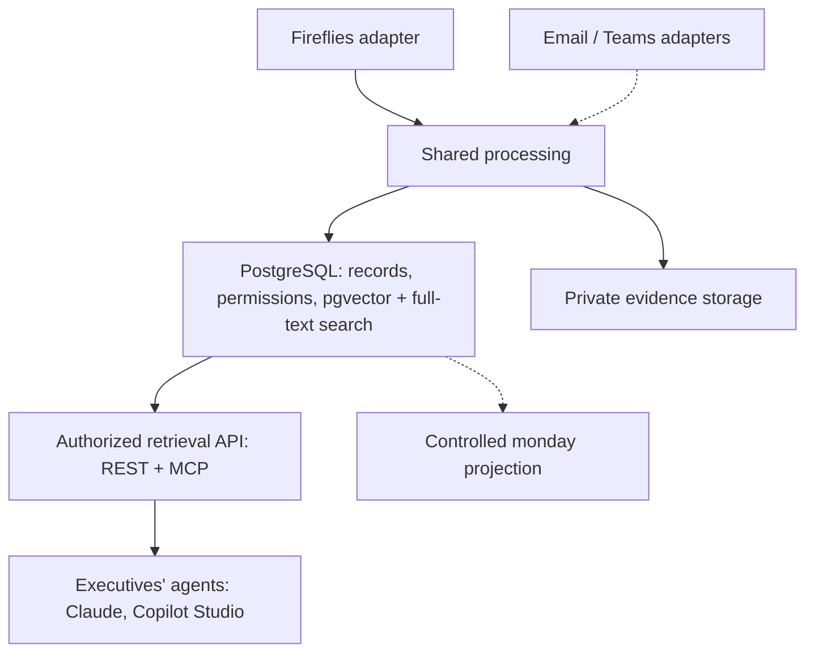

# Finishes Communication Intelligence

Shared communication intelligence platform for **Fireflies, email, Teams and Dialpad**. The first release is **authorized semantic search over Fireflies meetings** for executives and their agents; email follows, then Teams.

**Current status: planning and setup preparation.** This repository contains architecture/delivery plans, an Azure/Graph setup runbook, an executable identity bootstrap and a draft database migration (validated locally, not applied in Azure). No ingestion application, complete infrastructure template or deployment workflow is implemented here yet. No Azure resources have been deployed by this repository work. Runtime configuration examples remain proposed contracts.

## Start Here

| Document | Purpose |
|---|---|
| [Fireflies Pipeline](docs/FIREFLIES_PIPELINE.md) | First source: API facts, scope, capture, screening, changes/deletions, decisions |
| [Function Apps](docs/FUNCTION_APPS.md) | Ingestion and search apps, functions, jobs, identities, resource inventory |
| [Database](docs/DATABASE.md) | Schema, identity rules, publication fence, queue, roles; see [`db/migrations`](db/migrations) |
| [Search and Agents](docs/SEARCH_AND_AGENTS.md) | Chunking, embeddings, hybrid retrieval, authorization, REST/MCP agent access, evaluation |
| [Fireflies Release Backlog](docs/FIREFLIES_RELEASE_BACKLOG.md) | Ordered first-release tasks and PR sequence |
| [Architecture Decisions](docs/ARCHITECTURE_DECISIONS.md) | Proposed decisions, including Fireflies-first (ADR-010) and the simplified foundation (ADR-011/012/013) |
| [Platform Plan](docs/PLATFORM_PLAN.md) | Overall architecture, common data model, lifecycle and deployment strategy |
| [Azure and Graph Setup](docs/AZURE_AND_GRAPH_SETUP.md) | GitHub/Azure authentication, identities and (for the email release) scoped mailbox permissions |
| [Azure Bootstrap](scripts/bootstrap-azure.sh) | Cloud Shell script to create identities, federation and deployment roles in your existing resource group |
| [Email Layers and PDF Scope](docs/EMAIL_PIPELINE_AND_PDF_SCOPE.md) | Second release: email text plus PDF attachments only |
| [Email Deduplication](docs/EMAIL_DEDUPLICATION.md) | Second release: native message IDs, attachment fingerprints, duplicate-action prevention |
| [Email Release Backlog](docs/EMAIL_RELEASE_BACKLOG.md) | Second-release tasks on the shared foundation |
| [Email Acceptance Plan](docs/EMAIL_ACCEPTANCE_PLAN.md) | Email pilot scenarios and production release evidence |
| [Runtime Configuration Example](config/runtime.example.env) | Proposed setting names and safe starting values |

## Source Roadmap

| Source | Planned Coverage | Release Scope |
|---|---|---|
| Fireflies | Approved users' meeting transcripts, speakers, timestamps and (labelled) Fireflies summaries | **First release** |
| Microsoft 365 email | Approved user/shared mailboxes, sent/received mail, PDF attachment extraction/OCR and citations | Second; disabled |
| Teams | Authorized chats, channel messages and available meeting evidence | Third; disabled |
| Dialpad | Authorized calls, messages and available transcript/media evidence | Later; disabled |

Provider coverage, permissions and account entitlements must be verified before each adapter is built (for Fireflies: FF-001).

## Platform Shape

Source adapters handle provider authentication, capture, normalization and permissions. Shared processing handles screening, extraction/OCR (email), classification, chunking and embeddings. Search results must pass authorization and current publication checks before evidence reaches the agent. For the first release PostgreSQL is also the search index (ADR-012); Azure AI Search is added when measured volume or quality requires it.

## Fireflies First

1. Discovery: confirm the Fireflies plan's rate limit, admin-key visibility, webhook and schema (FF-001), and record the decisions (FF-002).
2. Foundation: repo scaffold, contracts, database migration, mode controller, development infrastructure through GitHub.
3. Capture approved users' meetings via webhook + reconciliation, with durable jobs, checkpoints and deletion detection.
4. Screen, chunk with speaker/time citations, embed, and publish atomically.
5. Serve authorized hybrid search through REST and MCP; evaluate retrieval quality.
6. Production stack (private networking, alerts, retention), pilot in `test` mode, then switch to `production`.

Email then reuses this foundation and adds its source-specific work; Teams follows email.

The operator control is planned as `INGESTION_MODE=test|production|paused`, stored for the first release as the active `runtime_config` revision in PostgreSQL (ADR-011). Test requires explicit scope IDs (Fireflies users, later mailboxes) plus test approval. Production uses only production-approved scopes and does not turn on other providers. All modes retain the security policy. See [ADR-004](docs/ARCHITECTURE_DECISIONS.md#adr-004-one-shared-mode-setting).

## Repository and Prototype

This is the authoritative repository: `Finishes-Solutions/fs-communication-intelligence`.

It was empty when inspected on September 25, 2026. The earlier email prototype in `mattsinitiere/fs-outlook-email-ingestion-tool` remains reference material. Its PR was closed as superseded; its code and passing tests have not been imported or represented as validation of this platform.

Committing these files does not create source permissions, ingest company communications, configure monday boards or deploy cloud services. The existing Azure resource group is `fs-communication-intelligence`. Running the bootstrap yourself creates managed identities, GitHub federation and deployment role assignments inside that group as described in the setup runbook.
