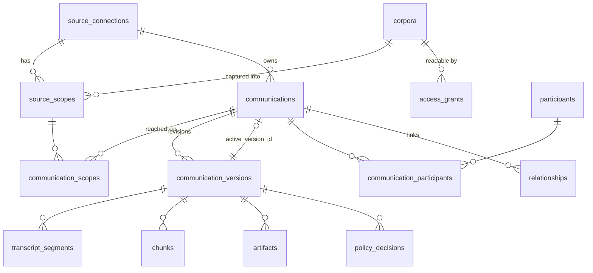

# Database Design

Status: draft schema in [`db/migrations/0001_foundation.sql`](../db/migrations/0001_foundation.sql). It was applied to a local PostgreSQL 16.13 + pgvector 0.6.0 instance on 2026-09-29 and exercised by [`db/tests/0001_foundation_checks.sql`](../db/tests/0001_foundation_checks.sql). It has not been applied to any Azure database.

Related: [Fireflies Pipeline](FIREFLIES_PIPELINE.md) · [Function Apps](FUNCTION_APPS.md) · [Search and Agents](SEARCH_AND_AGENTS.md)

## 1. Role of the Database

PostgreSQL (Azure Database for PostgreSQL Flexible Server) is authoritative for records, versions, permissions, execution state and audit. **For the first release it is also the search index** (pgvector + full-text search; [ADR-012](ARCHITECTURE_DECISIONS.md#adr-012-postgresql-search-for-the-first-release)). Blob storage holds raw provider payloads. Everything searchable can be rebuilt from Blob + SQL.

Everything lives in schema `ci`. The design is source-neutral: Fireflies, email and Teams share these tables, and provider-only details go in `provider_attributes` JSONB or later extension tables. No email-only column is mandatory.

## 2. Entity Overview



| Group | Tables |
|---|---|
| Control | `datasets`, `runtime_config`, `source_connections`, `source_scopes`, `corpora`, `access_grants`, `exclusions` |
| Evidence | `communications`, `communication_scopes`, `communication_versions`, `participants`, `communication_participants`, `artifacts`, `transcript_segments`, `chunks`, `relationships`, `tombstones` |
| Execution | `jobs`, `checkpoints`, `rate_budgets`, `webhook_receipts`, `outbox` |
| Governance | `policy_decisions`, `audit_events` |
| Retrieval surface | Views `published_communications`, `published_chunks`, `published_segments`, `published_participants` |

## 3. Identity Rules

- **Communication identity:** `(dataset_key, connection_id, native_id)`. `connection_id` fixes the provider and account.
- **Scope is a relationship, not part of identity.** A Fireflies transcript reached through two approved users is one communication with two `communication_scopes` rows. This refines the platform plan's identity rule. Email is unaffected: Graph immutable IDs are per-mailbox, so each mailbox copy is still its own communication, as [ADR-003](ARCHITECTURE_DECISIONS.md#adr-003-an-occurrence-is-distinct-from-a-conversation) requires.
- **A meeting found in both Fireflies and Teams** is two communications linked by a `relationships` row of kind `same_meeting`, with provenance. They are never merged, and their grants are never combined.
- **Datasets:** `test` and `production` rows never mix. A test record is not promoted to production; production capture re-fetches it.

## 4. Versions and the Publication Fence

Each processed source revision, under one processing profile, is a `communication_versions` row:

```
fetched → normalized → screened → embedded → published → superseded
                    ↘ held / rejected (reason code required)
any → failed (retryable via job) · published → withdrawn
```

`profile` records the normalizer, chunker, embedding model/dimensions and policy versions. Changing any of them creates a new version on reprocessing, rather than mutating published rows.

**Publication is one transaction:** set the new version `published`, set the prior active version `superseded`, and point `communications.active_version_id` at the new version. The foreign key is `DEFERRABLE`, so the order inside the transaction doesn't matter. Search reads only `published_*` views, which require the following (a sketch of these filters follows the list):

- `communications.active_version_id = chunk.version_id`, the version state `published` and `lifecycle_state = 'active'`;
- the communication's dataset equals `active_dataset()` (none when paused);
- no matching `exclusions` or `tombstones` row.

Partially written chunks for an unpublished version are therefore never visible. Withdrawal works by inserting a tombstone or exclusion first, which hides the item at once, then purging.

## 5. Durable Jobs

The queue is PostgreSQL, as [ADR-002](ARCHITECTURE_DECISIONS.md#adr-002-sql-is-authoritative-search-is-rebuildable) specifies.

```sql
-- Admit (webhook, reconcile, backfill); duplicates collapse on jobs_open_dedupe
INSERT INTO ci.jobs (dataset_key, config_revision, job_type, dedupe_key, payload, priority)
VALUES ($1, $2, 'ff_fetch', $3, $4, $5)
ON CONFLICT DO NOTHING;

-- Claim
WITH next AS (
  SELECT id FROM ci.jobs
  WHERE state = 'queued' AND run_after <= now()
  ORDER BY priority, run_after
  FOR UPDATE SKIP LOCKED LIMIT $1)
UPDATE ci.jobs j SET state = 'leased', lease_owner = $2,
       lease_expires_at = now() + interval '5 minutes', attempts = attempts + 1, updated_at = now()
FROM next WHERE j.id = next.id
RETURNING j.*;

-- Recover expired leases (maintenance)
UPDATE ci.jobs SET state = CASE WHEN attempts >= max_attempts THEN 'dead' ELSE 'queued' END,
       lease_owner = NULL, lease_expires_at = NULL, run_after = now(), updated_at = now()
WHERE state = 'leased' AND lease_expires_at < now();
```

Completion updates `state` only `WHERE id = $1 AND lease_owner = $2`. A worker that lost its lease cannot overwrite another worker's result. Payloads carry identifiers only, never transcript text.

**Rate budget** (shared across webhook fetches, reconcile and backfill; tested locally):

```sql
UPDATE ci.rate_budgets SET
  window_start = CASE WHEN now() >= window_start + make_interval(secs => window_seconds) THEN now() ELSE window_start END,
  used         = CASE WHEN now() >= window_start + make_interval(secs => window_seconds) THEN 1 ELSE used + 1 END
WHERE connection_id = $1
  AND (now() >= window_start + make_interval(secs => window_seconds)
       OR used + 1 <= max_requests - CASE WHEN $2 = 'backfill' THEN reserve_for_live ELSE 0 END)
RETURNING used;   -- no row returned = wait for the next window
```

## 6. Database Roles

| Role | Used by | Can | Cannot |
|---|---|---|---|
| `ci_ingest` | Ingestion app | Read all; write evidence, jobs, checkpoints, budgets, decisions; append audit | Change mode, scope approvals, reader grants or exclusions |
| `ci_search` | Search app | Read `published_*` views, `access_grants`, `corpora`, `runtime_config`; append audit | Read base tables (`chunks`, `transcript_segments`, …), so it can never see unpublished, excluded or tombstoned content |
| `ci_operator` | `admin_mode` function and administrators | Manage mode, connections, scopes, corpora, grants, exclusions and budgets | Read evidence content |
| Migration principal | GitHub migration job | Own the schema | Be used at runtime |

In Azure, each managed identity is created as a database principal with `pgaadauth_create_principal` and then granted membership in its role. The local checks confirm the denials above.

## 7. Where Content Lives

| Data | Location | Why |
|---|---|---|
| Raw Fireflies JSON | Private Blob, `raw/fireflies/<dataset>/<id>/<revision>.json` | Rebuild and audit source; not queried |
| Transcript sentences | `transcript_segments.text` | Needed for citations and transcript windows; small |
| Chunk text and embeddings | `chunks.display_text`, `chunks.embedding vector(1536)`, `chunks.tsv` | Search |
| Provider summary | `artifacts` (Blob) + a `provider_summary` chunk | Labelled as Fireflies AI output |
| Logs, audit, jobs | Identifiers, counts and reason codes only | Content-free by rule |

**Sizing:** about 42 hours of meetings is roughly 20–30k sentences and 1–2k chunks. At 1536 float4 dimensions, that is about 6 KB per embedding, so around 10 MB of vectors. A Burstable server is more than enough. Exact (non-index) vector scans are fast at this size; the HNSW index matters beyond roughly 100k chunks.

## 8. Retention and Purge

Maintenance purges `superseded` and `withdrawn` versions' chunks, segments and Blobs after a grace period (proposed 7 days, to allow rollback). Tombstones are kept for as long as the source may be replayed or restored. Backups follow the Flexible Server retention setting; deleting live rows does not remove backup copies immediately. Document the retention periods before production (FF-D8 in the backlog).

## 9. How Email and Teams Extend This

- **Email:** each mailbox copy is a `communications` row (`kind = 'email'`). The deduplication design's `email_content_variants`, `artifact_contents` and `processing_results` become extension tables keyed to `communication_versions` and `artifacts`. `chunks.chunk_kind` already allows `email_body` and `pdf_page` with `page_from`/`page_to`.
- **Teams:** `kind = 'chat_message' | 'channel_message' | 'meeting'`, with scopes of `teams_chat`/`teams_channel`, and `chat_context` chunks. Its ACLs probably need per-communication grants rather than one corpus. That is an additive `access_grants` target, planned during Teams discovery.

## 10. Open Items

- Replace `pgcrypto` if the server image provides `gen_random_uuid()` natively (PostgreSQL 13+ does, so it is only kept for safety).
- Confirm the pgvector version on Azure Flexible Server (the `azure.extensions` allowlist) and whether `hnsw.iterative_scan` is available for filtered queries at larger scale.
- Add a `schema_migrations` ledger when the migration runner is chosen.
