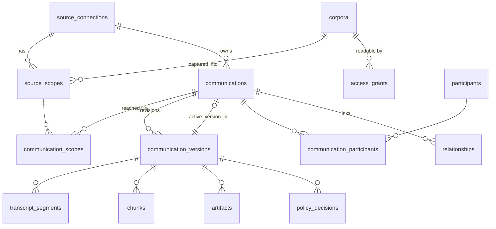

# Database Design

Status: schema in [`db/migrations`](../db/migrations): `0001_foundation.sql` (source-neutral), `0002_email.sql` (email extension), then `0003`–`0011` (processing, project risk, operations, attachment originals, signature images, label feedback, action people, properties and entities, longer backfill). CI applies them to PostgreSQL 18 + pgvector 0.8.2 on every pull request and runs the behavior checks in [`db/tests`](../db/tests). They have not been applied to any Azure database.

Related: [Function Apps](FUNCTION_APPS.md) · [Search and Agents](SEARCH_AND_AGENTS.md) · [Email Deduplication](EMAIL_DEDUPLICATION.md)

## 1. Role of the Database

PostgreSQL (Azure Database for PostgreSQL Flexible Server) is authoritative for records, versions, permissions, execution state and audit. **For the first release it is also the search index** (pgvector + full-text search; [ADR-012](ARCHITECTURE_DECISIONS.md#adr-012-postgresql-search-for-the-first-release)). Blob storage holds raw provider payloads. Everything searchable can be rebuilt from Blob + SQL.

Everything lives in schema `ci`. The foundation is source-neutral: email, Teams and any later source share it. Email-only details live in the `email_*` extension tables (§9), and no email-only column is mandatory in the shared tables.

## 2. Entity Overview



| Group | Tables |
|---|---|
| Control | `datasets`, `runtime_config`, `source_connections`, `source_scopes`, `corpora`, `access_grants`, `exclusions`, `schema_migrations` |
| Evidence | `communications`, `communication_scopes`, `communication_versions`, `participants`, `communication_participants`, `artifacts`, `transcript_segments`, `chunks`, `relationships`, `tombstones` |
| Execution | `jobs`, `checkpoints`, `rate_budgets`, `webhook_receipts`, `outbox` |
| Governance | `policy_decisions`, `audit_events` |
| Email extension | `email_mailboxes`, `email_messages`, `email_attachments` |
| Processing (0003) | `version_texts` (body and extracted attachment text), `classification_runs`, `classification_labels`; views `published_texts`, `published_classifications`, `published_email_attachments`, `coverage_counts` |
| Retrieval surface | Views `published_communications`, `published_chunks`, `published_segments`, `published_participants`, `published_email_messages`, `published_email_attachment_coverage` |

## 3. Identity Rules

- **Communication identity:** `(dataset_key, connection_id, native_id)`. `connection_id` fixes the provider and account.
- **Scope is a relationship, not part of identity.** Graph immutable IDs are per-mailbox, so each mailbox copy of an email is its own communication with one `communication_scopes` row, as [ADR-003](ARCHITECTURE_DECISIONS.md#adr-003-an-occurrence-is-distinct-from-a-conversation) requires. Copies are correlated by Internet Message-ID plus a verified content fingerprint and collapsed in results after authorization; permissions are never combined. A source whose items are shared across scopes may link one communication to several scopes.
- **The same item from two sources** (for example a meeting in Teams and in another recorder) is two communications linked by a `relationships` row, with provenance. They are never merged.
- **Datasets:** `test` and `production` rows never mix. A test record is not promoted to production; production capture re-fetches it.

## 4. Versions and the Publication Fence

Each processed source revision, under one processing profile, is a `communication_versions` row:

```
fetched → normalized → screened → embedded → published → superseded
                    ↘ held / rejected (reason code required)
any → failed (retryable via job) · published → withdrawn
```

`profile` records the normalizer, chunker, embedding model/dimensions and policy versions. Changing any of them creates a new version on reprocessing, rather than mutating published rows.

**Publication is one transaction:** set the new version `published`, set the prior active version `superseded`, and point `communications.active_version_id` at the new version. The foreign key is `DEFERRABLE`, so the order inside the transaction doesn't matter. Search reads only `published_*` views, which require the following (a sketch of these filters follows the list):

- `communications.active_version_id = chunk.version_id`, the version state `published` and `lifecycle_state = 'active'`;
- the communication's dataset equals `active_dataset()` (none when paused);
- at least one linked scope is `enrolled`, approved for that dataset, and has no active `scope` exclusion;
- no active `item` exclusion, no participant matching an active `participant_address` or `participant_domain` exclusion, and no tombstone.

**Scopes and exclusions.** `source_scopes.scope_state` records what inventory observed (`packages/ci_email/inventory.py`: reachable user/shared mailbox → `enrolled`, active scope exclusion or room/equipment mailbox → `excluded_by_rule`, Graph 403 → `no_exchange_access`, 404 → `no_mailbox`; `not_approved` is only the default before the first probe) (`enrolled`, `excluded_by_rule`, `not_approved`, `no_exchange_access`, `no_mailbox`, `paused`); ingestion can write it but cannot change the `test_approved`/`production_approved` flags, which are operator decisions. `exclusions` has four kinds: `item`, `scope` (for example a whole mailbox), `participant_address` and `participant_domain` (stored lowercase, without `@`). Exclusions are revocable (`revoked_at`), are checked at capture before content is staged, and are enforced again by the views, so an exclusion added later hides evidence already indexed. Excluding a mailbox does not hide that person's mail in other mailboxes; a participant exclusion does.

Partially written chunks for an unpublished version are therefore never visible. Withdrawal works by inserting a tombstone or exclusion first, which hides the item at once, then purging.

## 5. Durable Jobs

The queue is PostgreSQL, as [ADR-002](ARCHITECTURE_DECISIONS.md#adr-002-sql-is-authoritative-search-is-rebuildable) specifies.

```sql
-- Admit (webhook, reconcile, backfill); duplicates collapse on jobs_open_dedupe
INSERT INTO ci.jobs (dataset_key, config_revision, job_type, dedupe_key, payload, priority)
VALUES ($1, $2, 'email_fetch', $3, $4, $5)
ON CONFLICT DO NOTHING;

-- Claim
WITH next AS (
  SELECT id FROM ci.jobs
  WHERE state = 'queued' AND run_after <= now()
  ORDER BY priority, run_after
  FOR UPDATE SKIP LOCKED LIMIT $1)
UPDATE ci.jobs j SET state = 'leased', lease_owner = $2,
       lease_expires_at = now() + interval '5 minutes', attempts = attempts + 1, updated_at = now()
FROM next WHERE j.id = next.id
RETURNING j.*;

-- Recover expired leases (maintenance)
UPDATE ci.jobs SET state = CASE WHEN attempts >= max_attempts THEN 'dead' ELSE 'queued' END,
       lease_owner = NULL, lease_expires_at = NULL, run_after = now(), updated_at = now()
WHERE state = 'leased' AND lease_expires_at < now();
```

Completion updates `state` only `WHERE id = $1 AND lease_owner = $2`. A worker that lost its lease cannot overwrite another worker's result. Payloads carry identifiers only, never message content.

**Rate budget** (shared across webhook fetches, reconcile and backfill; tested locally):

```sql
UPDATE ci.rate_budgets SET
  window_start = CASE WHEN now() >= window_start + make_interval(secs => window_seconds) THEN now() ELSE window_start END,
  used         = CASE WHEN now() >= window_start + make_interval(secs => window_seconds) THEN 1 ELSE used + 1 END
WHERE connection_id = $1
  AND (now() >= window_start + make_interval(secs => window_seconds)
       OR used + 1 <= max_requests - CASE WHEN $2 = 'backfill' THEN reserve_for_live ELSE 0 END)
RETURNING used;   -- no row returned = wait for the next window
```

## 6. Database Roles

| Role | Used by | Can | Cannot |
|---|---|---|---|
| `ci_ingest` | Ingestion app | Read all; write evidence, email metadata, jobs, checkpoints, budgets, decisions; record observed scope state; append audit | Change mode, scope approvals, reader grants or exclusions |
| `ci_search` | Search app | Read `published_*` views, `access_grants`, `corpora`, `runtime_config`; append audit | Read base tables (`chunks`, `email_messages`, …), so it can never see unpublished, excluded or tombstoned content |
| `ci_operator` | `admin_mode` function and administrators | Manage mode, connections, scopes, corpora, grants, exclusions and budgets | Read evidence content |
| Migration principal | GitHub migration job | Own the schema | Be used at runtime |

In Azure, each managed identity is created as a database principal with `pgaadauth_create_principal` and then granted membership in its role. The local checks confirm the denials above.

## 7. Where Content Lives

| Data | Location | Why |
|---|---|---|
| Raw Graph message JSON | Private Blob, `raw/email/<dataset>/<mailbox>/<id>/<revision>.json` | Rebuild and audit source; not queried |
| Message metadata | `email_messages`, `email_attachments` (metadata only in E1) | Citations, dedup, coverage |
| Chunk text and embeddings | `chunks.display_text`, `chunks.embedding vector(1536)`, `chunks.tsv` | Search |
| Logs, audit, jobs | Identifiers, counts and reason codes only | Content-free by rule |

**Sizing:** company-wide email will reach hundreds of thousands to millions of chunks, at about 6 KB per 1536-dimension embedding. The HNSW index and `hnsw.iterative_scan = relaxed_order` (pgvector 0.8) are what keep permission-filtered queries returning full pages; the search app sets it per session, and an acceptance test lands with the search PR. Size the server from measured pilot volume.

## 8. Retention and Purge

Maintenance purges `superseded` and `withdrawn` versions' chunks, segments and Blobs after a grace period (proposed 7 days, to allow rollback). Tombstones are kept for as long as the source may be replayed or restored. Backups follow the Flexible Server retention setting; deleting live rows does not remove backup copies immediately. Retention periods are open decision D-R1; there is no automatic deletion until they are set.

## 9. How Email and Teams Extend This

- **Email (`0002_email.sql`):** each mailbox copy is a `communications` row (`kind = 'email'`) with an `email_messages` row (mailbox, Internet Message-ID exactly as delivered, conversation, received/sent times, direction, content fingerprint) indexed by `(mailbox_scope_id, received_at)`. `email_mailboxes` holds the inventory (primary SMTP address, recipient type). `email_attachments` holds per-version attachment metadata and its status under `ATTACHMENT_UNSUPPORTED_POLICY`. PDF extraction (E2) adds states and uses `chunks.chunk_kind = 'pdf_page'`.
- **Teams:** `kind = 'chat_message' | 'channel_message' | 'meeting'`, with scopes of `teams_chat`/`teams_channel`, and `chat_context` chunks. Its ACLs probably need per-communication grants rather than one corpus. That is an additive `access_grants` target, planned during Teams discovery.

## 10. Open Items

- Replace `pgcrypto` if the server image provides `gen_random_uuid()` natively (PostgreSQL 13+ does, so it is only kept for safety).
- Confirm pgvector 0.8.2 on the provisioned Azure Flexible Server (the `azure.extensions` allowlist).
- Classification proposals (model, policy version, input hash, per-label probability, decision) arrive with the processing PR as a new migration.

## 11. Migrations

Run `python db/migrate.py status` or `apply` with the standard `PG*` environment variables. Each `NNNN_name.sql` file runs in one transaction together with its `ci.schema_migrations` row, so files must not contain `BEGIN`/`COMMIT`. The runner refuses to continue if an applied file's checksum has changed: never edit an applied migration, add a new one. `python db/run_checks.py` applies everything to a throwaway database for each check file and also tests the ledger; it drops cluster-wide roles, so give it a server of its own. SQL goes to psql on standard input, and `CI_PSQL` can name a psql inside a container (`make migrate` uses the local stack's), so no local psql install is needed. Python database tests (`tests/db`) create and migrate their own `ci_pytest` database.
