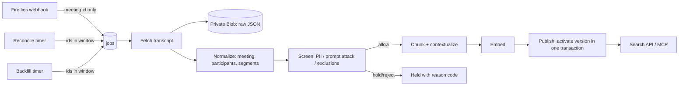

# Fireflies Meeting Pipeline (First Source)

Status: proposed design for the first release. Nothing here is deployed. Fireflies is now the first source; email and then Teams follow on the same foundation (see [ADR-010](ARCHITECTURE_DECISIONS.md#adr-010-fireflies-is-the-first-source)).

Related: [Function Apps](FUNCTION_APPS.md) · [Database](DATABASE.md) · [Search and Agents](SEARCH_AND_AGENTS.md) · [Fireflies Backlog](FIREFLIES_RELEASE_BACKLOG.md)

## 1. Why Fireflies First

Fireflies is a smaller and safer source than email:

| Email-release risk | Fireflies equivalent |
|---|---|
| Attachments, PDF extraction, OCR and malware gating | None. Transcripts arrive as structured JSON text |
| Defender threat and spam verdicts, historical threat coverage | Not applicable. Meetings are recorded by an invited bot, not delivered by outsiders |
| Cross-mailbox copies and deduplication | One transcript ID per meeting in the Fireflies team |
| Volume | Roughly 42 hours of transcripts in the account on 2026-09-29 (about 2,540 minutes) |

It still exercises everything the platform has to prove: scoped capture, a durable queue, screening, chunking with citations, embeddings, authorized retrieval, the test/production/paused switch, deletion and agent access. Email then adds only its source-specific work.

## 2. Known Fireflies API Facts and Open Items

Verified by the connector or from published documentation on 2026-09-29. Re-verify each item during discovery (FF-001) before relying on it.

| Topic | What we know | Design consequence |
|---|---|---|
| API | GraphQL at `https://api.fireflies.ai/graphql`, `Authorization: Bearer <API key>` | No managed identity. The key is a secret in Key Vault |
| Key ownership | Keys belong to a Fireflies user. The connected account (Matthew) is an admin | Assumption to test: an admin key can read team members' transcripts. Prefer a dedicated service or admin seat over a personal key |
| Rate limits | Business and Enterprise: 60 requests/minute. Lower tiers are much lower (reported as 50/day; **unverified**). `deleteTranscript` is 10/min | A shared `rate_budgets` row governs every caller. Backfill cannot starve live capture |
| Listing | `transcripts(fromDate, toDate, limit ≤ 50, skip, organizers, participants, user_id, …)`. Other integrators report replies silently capped at 50, and `skip` ordering not stable between calls | Page by narrow date windows. Treat a full page as "split the window". Dedupe by ID |
| Webhooks | Configured in Fireflies Developer Settings. Signed with HMAC-SHA256 in `x-hub-signature`. V1: `eventType: "Transcription completed"`, `meetingId`. V2: `event: meeting.transcribed`, `meeting.summarized`, `meeting.bot_joined`, `meeting_id` | Accept both payload shapes. Webhooks are a latency optimization; reconciliation is the source of truth |
| Deletions | No deletion webhook is known | Deletions are detected by reconciliation sweeps |
| Summaries | Generated by Fireflies AI, possibly after the transcript (`meeting.summarized`) | Re-fetch on the summary event. Store summaries as a provider-summary artifact, never as a decision |
| Media | Audio/video URLs are plan-dependent and expire | Not stored in the first release (decision FF-D4) |
| Channels | The account has no channels today | Channel membership is not used for access in the pilot |
| Existing integrations | The account has an active Zapier integration | Inventory what it sends before launch, so the platforms don't double-write into monday or elsewhere |

## 3. Pipeline Layers



### 3.1 Scope: what may be captured

A Fireflies scope is a Fireflies **user** (`scope_kind = 'fireflies_user'`), analogous to a mailbox. A meeting is in scope when its organizer, or a Fireflies user whose meetings we list, is an approved scope for the active mode. Each scope maps to a **corpus** (the unit readers are granted). The pilot uses one corpus, `fireflies-executive`.

- `test` mode: only scopes with `test_approved`, intersected with `FIREFLIES_TEST_USER_IDS`. Empty means capture nothing.
- `production` mode: only `production_approved` scopes.
- Every scope needs a `backfill_since`. If it is empty, initial capture is blocked.
- `exclusions` lists individual meetings (for example HR or board meetings). It is checked at capture and again at retrieval. Title-keyword auto-exclusion (for example "HR", "1:1", "comp") is proposed as a **hold for review** rule, not a silent skip (FF-D2).

### 3.2 Capture

1. **Webhook** (`ff_webhook`): verify the HMAC over the raw body in constant time before parsing. Accept V1/V2 shapes. On a transcribed or summarized event, admit a `ff_fetch` job keyed by `connection:meeting_id`. Duplicates collapse on the unique open-job index. Record a content-free `webhook_receipts` row. Return 200 quickly and never log bodies. Scope is **not** decided here, because the payload doesn't carry enough information; the fetch step decides.
2. **Reconcile** (`ff_reconcile`, every 30 min): for each approved scope, list transcripts in a rolling window (default 14 days) using narrow date windows and ID-deduped paging. Enqueue unseen IDs and IDs whose light metadata (title, duration, date) changed. A nightly sweep lists IDs back to `backfill_since` to detect deletions: an ID that disappears in two consecutive sweeps gets a `withdraw` job.
3. **Backfill** (`ff_backfill`): walk backward from now to `backfill_since` in date windows, holding a `checkpoints` cursor. Backfill uses only the rate budget above `reserve_for_live`, and its jobs get a lower priority than live ones.

### 3.3 Fetch and stage

`ff_fetch` re-checks the active config revision and the scope before any source read, then requests one transcript. It stores the raw JSON in private Blob storage at `raw/fireflies/<dataset>/<meeting-id>/<source-revision>.json`. The source revision is the SHA-256 of a canonical, sorted JSON serialization of the content fields. If an identical source revision and processing profile already exist, the job ends without creating a new version.

Fields expected from the Transcript schema (confirm in FF-001): `id, title, date, duration, organizer_email, host_email, participants, meeting_attendees, speakers{id,name}, sentences{index,speaker_id,speaker_name,text,raw_text,start_time,end_time}, summary{overview,action_items,keywords,…}, transcript_url`.

### 3.4 Normalize

- `communications`: `kind = 'meeting'`, title, `occurred_at` (UTC from epoch milliseconds), duration, source URL and content-free provider attributes.
- `participants` + `communication_participants`: the organizer, attendees and speakers. Emails are normalized. Speaker labels that are just "Speaker 2" stay unresolved rather than guessed.
- `transcript_segments`: one row per sentence, with the sentence index as `seq`, times converted from seconds to milliseconds, and `text` (cleaned, not `raw_text`).
- `artifacts`: `raw_payload`, and a `provider_summary` when present.

### 3.5 Screen

Screening runs on segment text and the provider summary **before** embedding:

| Check | Service | Pilot rule |
|---|---|---|
| Sensitive data | Azure AI Language PII detection | **Hold** the meeting when SSN, bank/credit card numbers, passwords or health categories are detected above a confidence threshold. Names, emails, phone numbers and company names are expected in meetings and are **allowed**. Exact categories and thresholds are decision FF-D3 |
| Prompt attack | Azure AI Content Safety Prompt Shields (document mode) | Hold on detection. Transcripts are low-risk but still untrusted text that agents will read |
| Exclusions | `exclusions` table, title rules | Hold (title rule) or reject (explicit exclusion) |

A failed or unavailable check leaves the version `pending`/retrying, never `allow`. Decisions go to `policy_decisions` with reason codes only. Whole-meeting hold is the conservative pilot rule. Segment-level redaction is a later option.

### 3.6 Chunk, embed, publish

See [Search and Agents](SEARCH_AND_AGENTS.md). Publication writes all chunks for the new version, then in **one transaction** sets the version `published`, marks the previous version `superseded` and points `communications.active_version_id` at the new version. Search reads only through `published_*` views.

### 3.7 Changes and deletions

| Source event | Handling |
|---|---|
| Transcript edited (speaker rename, text fix) or summary added | New source revision → new version → atomic swap; the old version's chunks are purged by maintenance |
| Meeting deleted in Fireflies | `withdraw` job: tombstone first (retrieval stops at once), then `lifecycle_state = 'deleted_at_source'`, then chunk/segment/Blob purge |
| Operator exclusion | Insert into `exclusions` (retrieval stops at once), then withdraw as above |
| Scope removed or approval revoked | Withdraw every communication reachable only through that scope |

## 4. Configuration

```dotenv
SOURCE_FIREFLIES_ENABLED=true
FIREFLIES_API_URL=https://api.fireflies.ai/graphql
FIREFLIES_API_KEY_SECRET_NAME=fireflies-api-key          # Key Vault secret name, not the key
FIREFLIES_WEBHOOK_SECRET_NAME=fireflies-webhook-secret   # Key Vault secret name
FIREFLIES_TEST_USER_IDS=                                 # empty = capture nothing
FIREFLIES_BACKFILL_SINCE=                                # empty = block initial capture
FIREFLIES_RATE_LIMIT_PER_MINUTE=60                       # set from the verified plan
FIREFLIES_RATE_RESERVE_FOR_LIVE=20
FIREFLIES_RECONCILE_WINDOW_DAYS=14
```

## 5. Decisions Needed

| ID | Decision | Proposed default |
|---|---|---|
| FF-D1 | Fireflies plan tier; which seat owns the API key and webhook | Dedicated admin or service seat. Matthew's key only for development |
| FF-D2 | Reader audience; restricted meeting types | Executive app role only. HR/board/1:1 meetings excluded or held |
| FF-D3 | PII categories that hold a meeting | Government IDs, financial account numbers, credentials, health |
| FF-D4 | Store audio/video? | No |
| FF-D5 | Index the Fireflies AI summary? | Yes, as a separate chunk kind, labelled as a Fireflies summary |
| FF-D6 | Pilot scope users and backfill boundary | Matthew plus 1–2 named organizers; 2026-01-01 |
| FF-D7 | What the existing Zapier integration does | Inventory before launch; no changes by this project |
| FF-D8 | Retention periods: raw payloads, superseded versions, held meetings, audit | Match the Fireflies retention setting for evidence; 7-day grace for superseded versions; audit 1 year |
| FF-D9 | Log search query text in audit? | No, by default; queries can themselves be sensitive |

## 6. Required Tests

- Bad or missing signature, a replayed webhook, V1 and V2 payloads, and unknown events.
- Duplicate webhook plus reconcile for the same meeting: one open job, one version.
- A meeting outside the approved scope: fetched metadata is rejected before staging.
- Empty `FIREFLIES_TEST_USER_IDS` or `FIREFLIES_BACKFILL_SINCE`: capture fails closed.
- A full 50-result page: the window splits and nothing is silently dropped.
- 429/5xx responses: backoff, budget accounting, and backfill yields to live work.
- Transcript edit or late summary: the new version swaps atomically and old chunks are never returned.
- Deleted meeting: two missed sweeps lead to a tombstone, then no results, then purge.
- PII or prompt-attack sample: held with a reason code; nothing embedded.
- Screening service outage: stays pending, never published.
- Mode changes to `paused`: no source reads and no retrieval results.

## References

- [Fireflies rate limits](https://docs.fireflies.ai/fundamentals/limits)
- [Fireflies webhooks](https://docs.fireflies.ai/graphql-api/webhooks) and [Webhooks V2](https://docs.fireflies.ai/graphql-api/webhooks-v2)
- [Fireflies transcripts query](https://docs.fireflies.ai/graphql-api/query/transcripts) and [Transcript schema](https://docs.fireflies.ai/schema/transcript)
